# liquid-gpu

The iOS 27 UI rebuilt for the web: Liquid Glass, the system springs, UIScrollView physics, gestures, navigation, sheets, menus and controls, as React 19 components.

**Live demo: [liquid.shelia.me](https://liquid.shelia.me)** (open it on a phone, or in a narrow window).

Glass is drawn with WebGPU through the HTML-in-Canvas API in Chrome, with a CSS (`backdrop-filter`) renderer everywhere else (Safari, Firefox). Every constant comes from an extraction of compiled UIKit, cited next to the code; values not found there are marked `TODO(unknown)`. See [`ARCHITECTURE.md`](./ARCHITECTURE.md).

<p>
  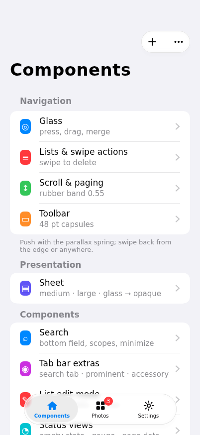
  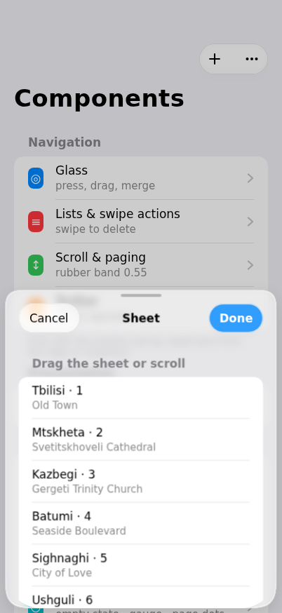
  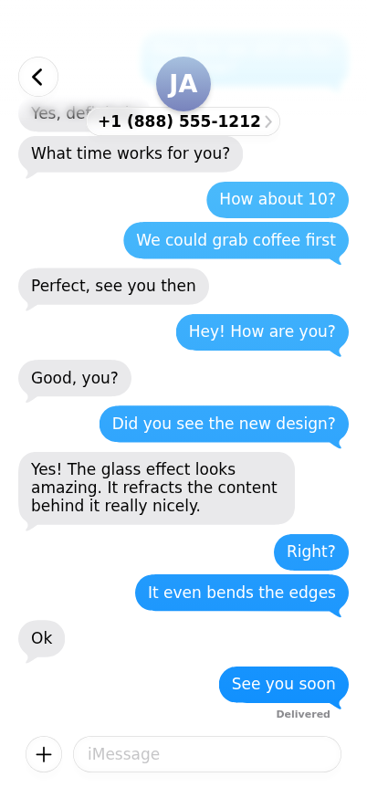
  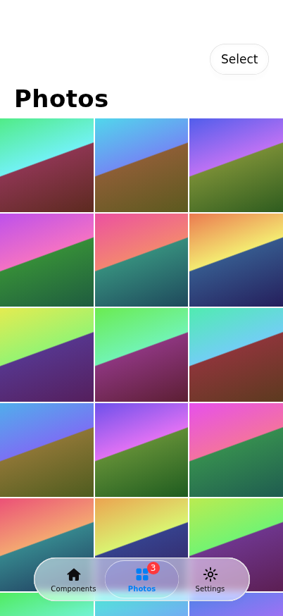
</p>

## Packages

| Package | What it is |
|---|---|
| `packages/core` (`@liquid-gpu/core`) | Framework-free: springs and the rAF `Animator`, scroll physics, gesture decision rules, tokens, haptics |
| `packages/gpu` (`@liquid-gpu/gpu`) | WebGPU device, HTML-in-Canvas capture, compositor, glass renderer, CSS fallback renderer |
| `packages/react` (`@liquid-gpu/react`) | React 19 components |
| `packages/json-render` (`@liquid-gpu/json-render`) | Render streamed JSON UI specs (generative UI) with the components |
| `apps/demo` | Vite showcase, deployed to [liquid.shelia.me](https://liquid.shelia.me) |

## Components

Every screen below is a live page on the demo site; the screenshots are taken from it with [`scripts/screenshots.mjs`](./scripts/screenshots.mjs).

| | | |
|---|---|---|
| **Components home** · [open](https://liquid.shelia.me/) <br> `NavigationStack`, `Screen` with large title, `List`, `Section`, `Row`, `BarButton`, `TabView`, pull to refresh <br> | **Dark appearance** · [open](https://liquid.shelia.me/?dark) <br> Same tree with `?dark`; every colour has light, dark and high-contrast values <br>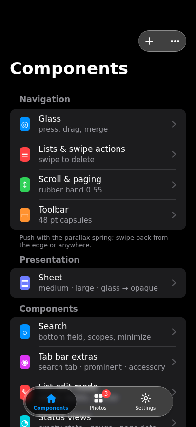 | **Glass** · [open](https://liquid.shelia.me/?push=glass) <br> `Glass` / `useGlass`: press and drag stretch, touch glow, shapes merging in a group <br>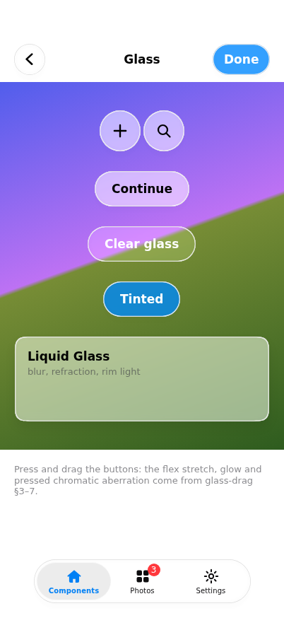 |
| **Lists & swipe actions** · [open](https://liquid.shelia.me/?push=list) <br> Inset grouped rows, swipe to delete / pin, full-swipe confirm <br>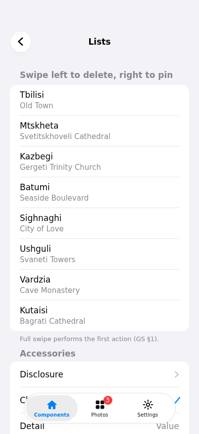 | **Scroll & paging** · [open](https://liquid.shelia.me/?push=scroll) <br> `ScrollView`: deceleration 0.998, rubber band 0.55, paging, indicator <br>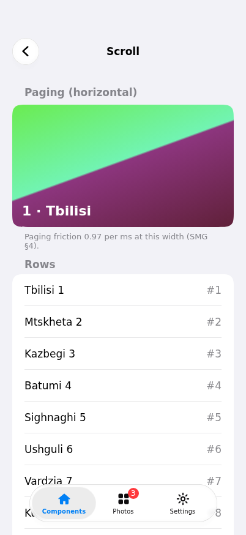 | **Toolbar** · [open](https://liquid.shelia.me/?push=toolbar) <br> `Toolbar`, `ToolbarSpacer`, 48 pt glass capsules <br>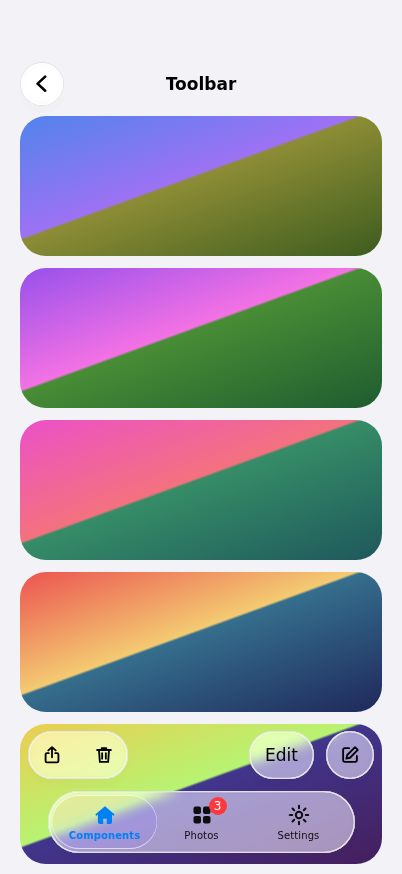 |
| **Sheet** · [open](https://liquid.shelia.me/?sheet=1) <br> `Sheet`: medium and large detents, glass at medium → opaque, scroll hand-off <br> | **Tab bar: Photos** · [open](https://liquid.shelia.me/?tab=photos) <br> `TabView` with the liquid lens selection, badge, minimize on scroll <br> | **Tab bar: Settings** · [open](https://liquid.shelia.me/?tab=settings) <br> Settings-style list in a tab <br>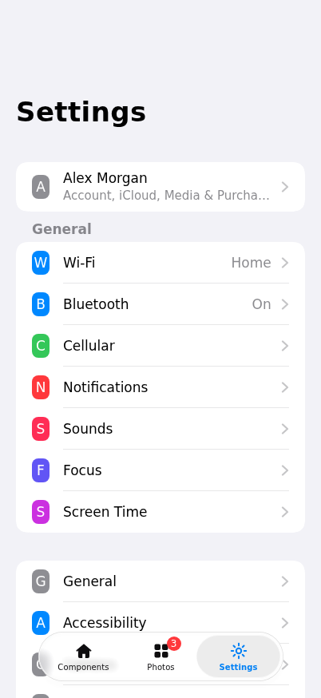 |
| **Photos** · [open](https://liquid.shelia.me/photos) <br> `ZoomTransition` (tap to open, swipe down to close), context-menu preview <br>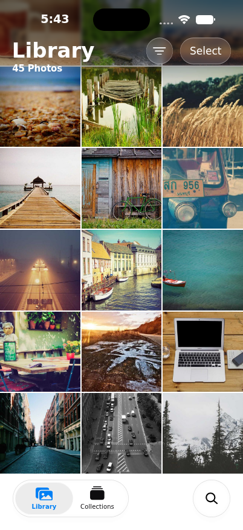 | **Messages-style chat** · [open](https://liquid.shelia.me/chat) <br> `ChatScreen`, `ChatTranscript`, `ChatInputBar`: bubble tails, send animation <br> | **Chat, dark** · [open](https://liquid.shelia.me/chat?dark) <br> Bubble gradients and glass in dark appearance <br>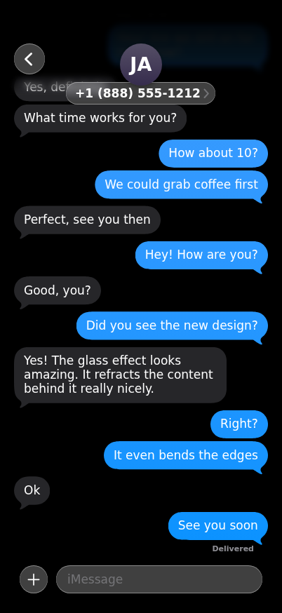 |
| **Controls** · [open](https://liquid.shelia.me/controls) <br> `Button` styles, `Switch`, `Slider`, `Stepper`, `SegmentedControl`, `Menu`, `ProgressView` <br>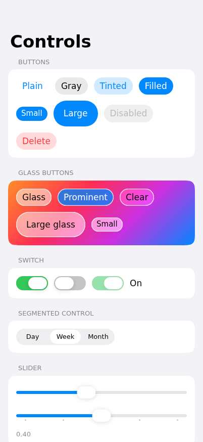 | **Search** · [open](https://liquid.shelia.me/search) <br> `Searchable`, `SearchBar`: bottom field, scope bar, minimize <br>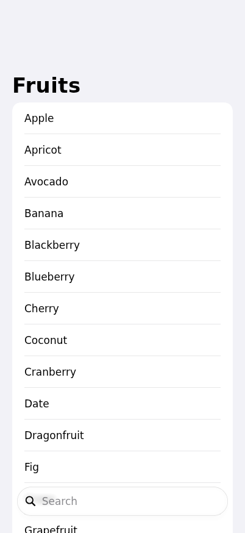 | **Tab bar extras** · [open](https://liquid.shelia.me/tabbar-extras) <br> Search tab, prominent tab, bottom accessory <br>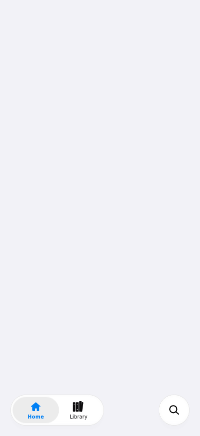 |
| **List edit mode** · [open](https://liquid.shelia.me/list-edit) <br> Selection, delete, drag to reorder <br>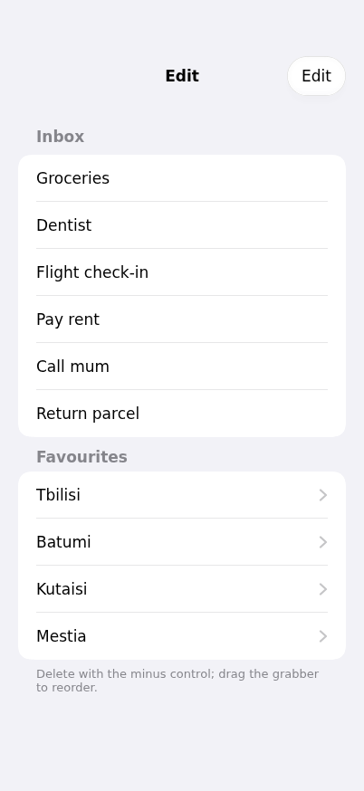 | **Status views** · [open](https://liquid.shelia.me/status) <br> Empty state, `Gauge`, `PageControl`, `Toast` <br>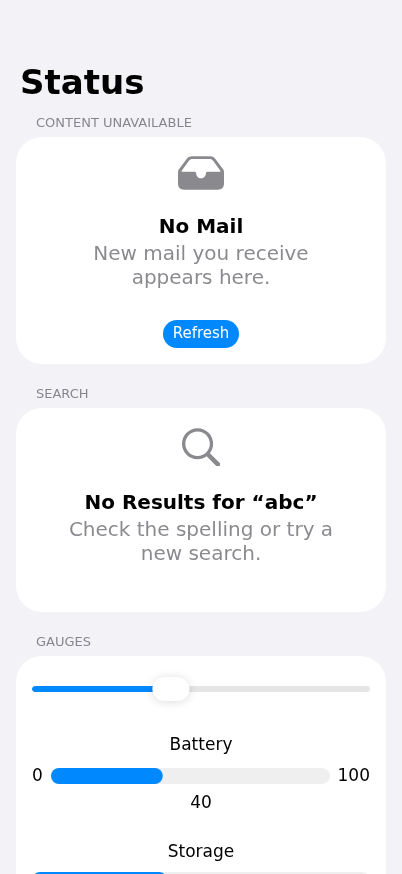 | **Basics** · [open](https://liquid.shelia.me/basics) <br> `DisclosureGroup`, `LabeledContent`, group box <br>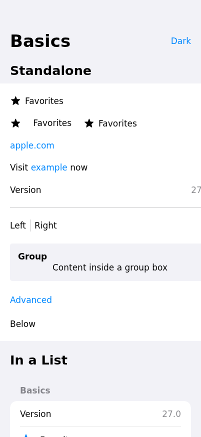 |
| **Generative UI** · [open](https://liquid.shelia.me/genui) <br> `@liquid-gpu/json-render`: component catalog, streaming specs <br>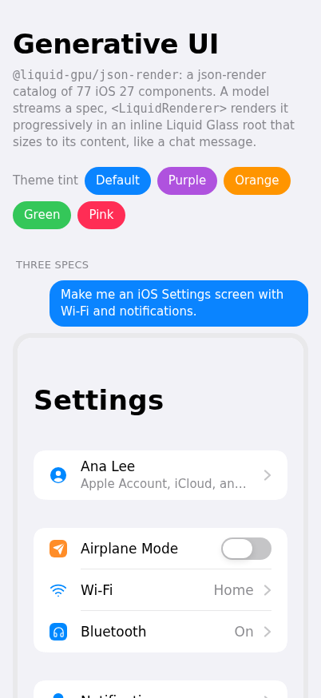 | **Inline roots** · [open](https://liquid.shelia.me/inline) <br> `LiquidRoot mode="inline"`: glass UI inside a page or a chat message, theming <br>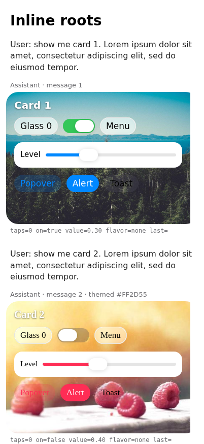 | **Charts** · [open](https://liquid.shelia.me/charts) <br> Bar, line, area, pie, metric <br>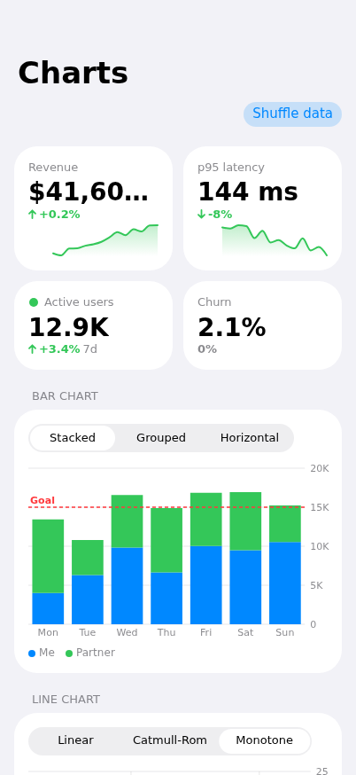 |
| **Form** · [open](https://liquid.shelia.me/form) <br> `Form`, fields, validation, submit <br>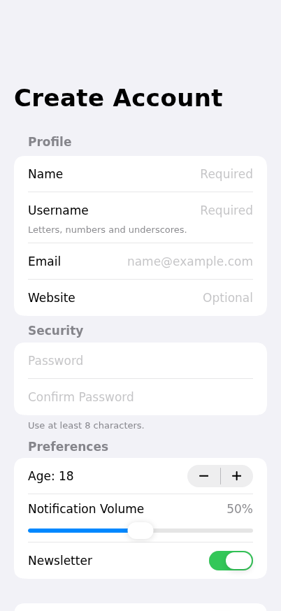 | **Pickers** · [open](https://liquid.shelia.me/picker) <br> Menu, inline, segmented and wheel pickers <br>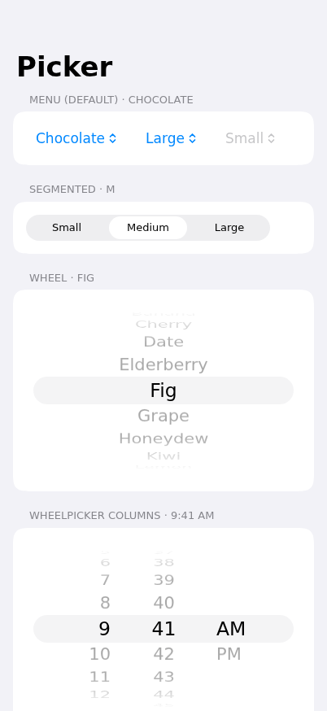 | **Inputs** · [open](https://liquid.shelia.me/inputs) <br> `TextEditor`, `ColorWell`, `Toggle`, `Rating`, `OneTimeCodeField` <br>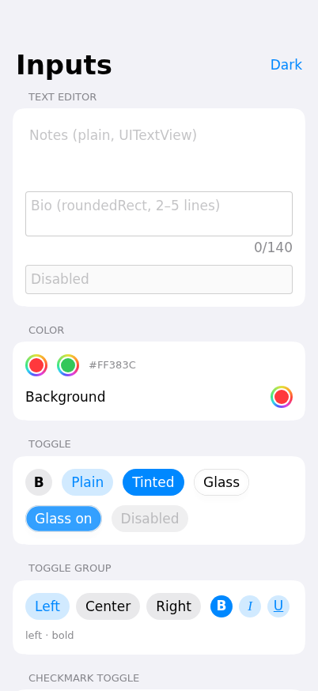 |
| **Media** · [open](https://liquid.shelia.me/media) <br> `Image`, `Avatar`, `Badge`, `Skeleton` <br>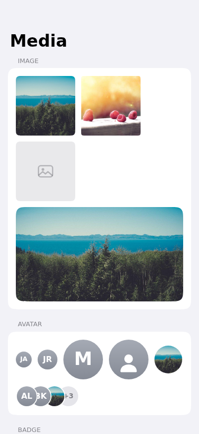 | **Icons** · [open](https://liquid.shelia.me/icons) <br> 270 named symbols <br>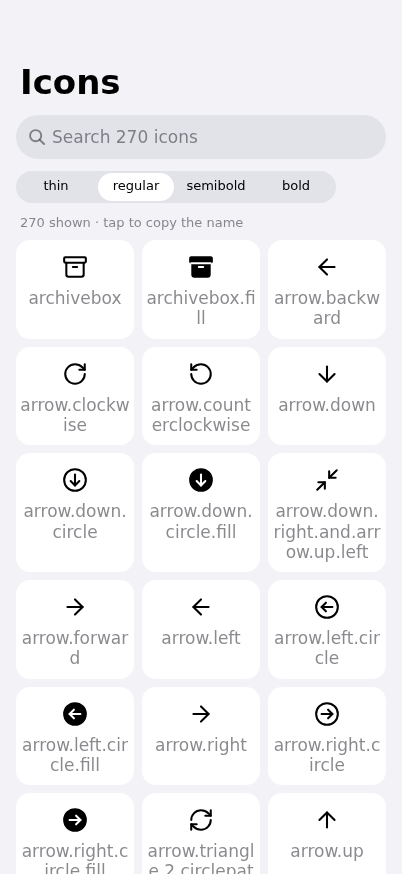 | **Layout & text** · [open](https://liquid.shelia.me/layout-text) <br> Stacks, grid, the type scale <br>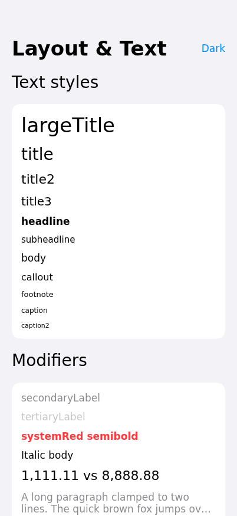 |

Demo URL options: `?dark`, `?light`, `?fallback` (force the CSS renderer), `?tab=photos|settings`, `?push=glass|list|scroll|toolbar`, `?sheet=1`, `?scroll=<pt>`, `?desktop`.

## Performance

The kit targets 120 Hz: one rAF loop for every spring and scroll view, no React re-render per frame (springs write layer transforms directly), and the loop stops when everything has settled.

How the two renderers draw:

- **WebGPU (Chrome with HTML-in-Canvas).** Each moving surface (screen, sheet, bar content, menu) is captured once into a texture and moved by the GPU compositor. Glass samples a mip chain of the composite below it.
- **CSS (Safari, Firefox).** Layers are absolutely positioned elements on their own compositing layers (`will-change: transform`), so moves, opacity, dimming and inset clips run on the compositor. Glass is a `backdrop-filter` element. Style writes are cached, so a frame only touches properties whose values changed.

Measured on the CSS renderer in WebKit (Playwright, iPhone 15 Pro viewport), before and after the iOS Safari pass in November 2026:

| | Before | After |
|---|---|---|
| rAF callbacks while idle (2 s) | 120 (never idled) | **0** |
| Inline style mutations while idle (2 s) | 720 | **0** |
| Style mutations during a drag and fling (3 s) | 1,957 | **772** (all real value changes) |
| Forced layouts per frame from layer clips | 1 per clipped layer | **0** (`calc(100% − …)` insets) |
| Idle glass blend layers (`plus-lighter` glow) | 1 per glass shape | **0** (only while a touch glows) |
| Sheet-sized backdrop blur under the opaque large sheet | always on | **dropped once opaque** |

Browser limits that no amount of code removes:

- **iOS Safari caps `requestAnimationFrame` at 60 Hz** (30 Hz in Low Power Mode). Native overflow scrolling runs in the UI process at 120 Hz. The kit drives scrolling in JavaScript (`touch-action: none`) to get exact UIKit physics and the sheet scroll hand-off, so its scrolling cannot exceed 60 fps on iPhone.
- **Every `backdrop-filter` is its own blur pass in the iOS render server**, outside the page's process. A frame can be late even when the page's own work is ~1 ms. Cost grows with the number and area of glass shapes on screen.
- **Web Inspector's Screenshots instrument** software-renders the page every frame and caps a recording near 30 fps. Turn it off when profiling.

## Develop

```sh
npm install
npm test          # vitest, all workspaces
npm run typecheck # tsc --noEmit per workspace
cd apps/demo && npm run dev          # http://localhost:5179 (add ?fallback for the CSS renderer)
node scripts/screenshots.mjs         # refresh docs/screenshots (needs a context.dev key in ~/.context-dev-key)
```

## TODO

Performance (iOS Safari):
- [ ] Optional native scrolling on touch devices (`touch-action: pan-y` + `scroll` events): 120 Hz and off the main thread, at the cost of the JS-driven sheet hand-off and refresh control.
- [ ] Stop resizing the sheet's glass every frame while it presents: each resize re-allocates its compositing layer and repaints the box shadow.
- [ ] Skip `frame()` work for layers and glass that did not change (dirty flags), instead of diffing every property of every shape.
- [ ] Cull glass shapes fully covered by an opaque layer above them (generalise the sheet fix).
- [ ] A frame-time HUD in the demo (`?perf`) to compare devices without Web Inspector.

Fidelity:
- [ ] CSS renderer: glass groups do not merge (no smooth-min union) and have no refraction or chromatic aberration.
- [ ] CSS renderer: the edge ring is uniform; on device it is darker at the capsule ends (≈30 %) than at the top and bottom (≈10 %).
- [ ] Resolve the remaining `TODO(unknown)` constants (spinner geometry, wheel-picker dark colours, glow dissipation, reduce-motion spring, BlurOpacity → α mapping and others; `grep -rn "TODO(unknown)" packages`).
- [ ] Wheel and trackpad gesture end is guessed from 90 ms of silence (the web has no momentum phase).

Project:
- [ ] Choose a license.
- [ ] Publish the packages to npm (`@liquid-gpu/core`, `gpu`, `react`, `json-render`).
- [ ] CI: tests, typecheck and a demo build on every push.
- [ ] Chrome without HTML-in-Canvas, Firefox and Android: test matrix and screenshots.

## Credits

Portions of the tab bar lens are adapted from [robinWongM/liquid-glass](https://github.com/robinWongM/liquid-glass) (Apache 2.0); see [`THIRD_PARTY_NOTICES.md`](./THIRD_PARTY_NOTICES.md). Demo photos: Lorem Picsum / Unsplash License ([`CREDITS.md`](./apps/demo/public/photos/CREDITS.md)).
